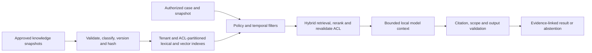

# Security retrieval architecture

Proposed. Retrieval augments a bounded investigation with citable knowledge. The evidence registry remains authoritative for tenant observations. A retrieved passage may support an interpretation or hypothesis; it conveys no action authority.

## Source catalog

| Data class | Examples and admission rule |
|---|---|
| Public, terms still reviewed | ATT&CK, D3FEND, CISA KEV, CVE/advisory snapshots, selected NVD data, Sigma/YARA metadata and Wazuh rules. Verify the specific revision, usage terms, attribution and redistribution before including content. |
| Licensed or provider-restricted | Commercial intelligence reports, rules, provider advisory data and STIX/TAXII feed packages. Store source license and permitted tenant/use. Exclude material with unclear rights. |
| Tenant-private | Internal incidents, historical investigations, SOC runbooks, approved playbooks, detections, asset inventory, architecture and reviewed analyst outcomes. Keep owner, purpose, disclosure and retention policy. |
| Restricted | Credential material, incident artifacts with sensitive identifiers, tightly scoped playbooks and regulated evidence. Exclude by default. Approve a specific projection and storage boundary before indexing. |

ATT&CK provides a machine-readable STIX dataset suitable for a reviewed offline snapshot. Pin the release digest and track technique revision and deprecation. [MITRE ATT&CK data](https://attack.mitre.org/resources/attack-data-and-tools/)

## Ingestion and retrieval

Version each document by source ID, tenant or shared-public scope, classification, ACL/policy epoch, checksum, timestamp, effective interval, expiry, and intake review. Parse in a constrained process, cap bytes/chunks and reject malformed or duplicate identifiers. Keep immutable source snapshots plus a revocation or correction ledger. Derive chunks by stable locators and pin parser, embedding and index generations. Version query, ranking, and reranker models independently. Reindex via a new generation and switch only after isolation and completeness checks.

Filter by authenticated tenant, data rights, classification, source status and temporal relevance **before** candidate retrieval. Recheck each returned passage and citation, including after reranking. Cache by tenant, permission/policy epoch, query and source generation. Treat vector embeddings as sensitive as their source. Avoid sharing tenant index namespaces unless enforcement can be independently demonstrated. After declassification, withdrawal, tenant deletion or grant revocation, visibly invalidate cache and search generations. Backup and restore preserve the same constraints.

Fuse lexical exact matches and local vector candidates. Prefer vocabulary-aware lexical retrieval for technique and indicator IDs. Rerank bounded candidates locally, deduplicate sources, limit context bytes and preserve document IDs, chunk hashes, locators and time context. When evidence conflicts, retain both claims and sources. Missing or unauthorized context returns abstention or a deterministic citation list. A reranker or model cannot widen scope.

Treat retrieved instructions as untrusted, separate them from system instructions and tool arguments, and validate every outbound action via policy. Reject dangling, altered, stale and disallowed citations. Require quoted spans to resolve to the exact source revision. Log request/query IDs, hashes, ranking versions and safe metrics without raw sensitive passages. Evaluate poisoning and injection independently of retrieval accuracy. [Evaluation](model-evaluation.md)

## Technology choices

| Candidate | Tradeoff |
|---|---|
| PostgreSQL lexical search with pgvector when justified | Reuse relational ownership, transactions and recovery controls. Tenant filtering and approximate-index behavior need verification. An extension and its migration require review. [pgvector](https://github.com/pgvector/pgvector) |
| Qdrant | Dedicated vector workload isolation and vector query capabilities. Adds another authorization, deletion, backup and consistency boundary. |
| OpenSearch | Useful for large lexical and hybrid workloads. Requires independent access policy, reindex and cross-index leakage testing. |
| Neo4j | Consider for relationship traversal when measured graph benefits justify additional operations and security ownership. Start from relational provenance. [Graph proposal](knowledge-graph.md) |
| Local embedding and reranking | Compare model rights, model digest, latency, language coverage, memory and attribution value. Pin models offline. A reranker is optional until it improves a held-out benchmark. |

Start with a small local lexical baseline and exact embedding search over an approved single-source corpus. Add PostgreSQL/pgvector once measurement supports the dependency. Keep the service contract independent of the index engine.

## First milestone

Use one reviewed ATT&CK release, one pinned local embedding model and a retrieval API in an offline harness. Index one shared-public collection and two synthetic tenant-restricted control collections to verify authorization. Return cited technique IDs and exact passages with digests. Provide at least 30 labeled queries with positive, ambiguous, no-match and cross-tenant cases. Report Recall@5, nDCG@5, citation precision, denial and abstention rates against lexical-only search. Require every returned citation to resolve to an authorized source revision, zero cross-tenant results, reproducible indexing, and correct abstention on all denied/expired fixtures. Report any retrieval regression before proposing hybrid promotion. No live inference, connector or response activation belongs to this milestone.
