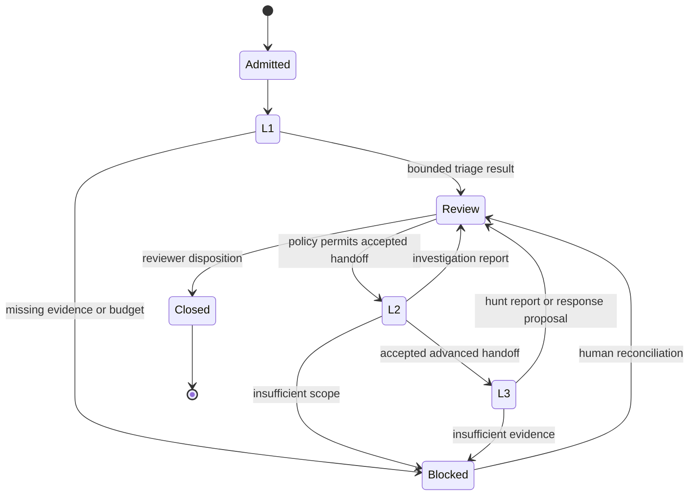

# Analyst orchestration and handoffs

The existing [offline L1 orchestrator](../../services/api/app/analysts/orchestration.py) accepts synthetic tasks and a fake provider. A receipt and binding check support a proposed-only result review. The [analyst protocol](../security/analyst-ai03-protocol.md) is the source for existing handoff contracts. The production state machine below is proposed.

| Tier | Responsibilities and output |
|---|---|
| L1 triage | Summarize alert evidence, identify likely benign explanations, propose severity and confidence, request approved enrichment, record missing context and recommend disposition or escalation. |
| L2 investigation | Correlate users, hosts, processes, network activity and indicators. Build a timeline, test alternatives, bound incident scope, and cite evidence for ATT&CK mapping or further escalation. |
| L3 hunting and response planning | Investigate campaign scope, persistence and lateral movement from approved evidence. Propose containment, remediation and reviewed detections. Forward action proposals to policy and approval. |

A handoff carries tenant, task and case IDs, tier, immutable snapshot digest, exact evidence IDs, hypothesis alternatives, supporting and contradictory observations, gaps, confidence rationale, requested tools and budgets, and previous disposition. Record actor and policy decisions. Receivers verify scope and current access. Confidence reflects evidence sufficiency and calibrated evaluation; low confidence or missing evidence can trigger abstention or human review. A model-generated escalation request cannot transition the workflow.

For production, persist transition and handoff atomically. Use an idempotent key over case, stage and snapshot. Retry only safe transport failures with capped attempts and deadlines. Preserve immutable attempts and cancel on revoked access. Re-run against a new snapshot if evidence changed. Malformed output, exhausted budgets, and stale approvals enter explicit denial or reconciliation states. Keep deterministic triage and human workflows available without models.
