# Alert-to-response data flow

```mermaid
flowchart LR
    Auth["Existing authenticated tenant and integration scope"] --> Pull["Existing bounded read-only Wazuh pull"]
    Pull --> Raw["Existing raw evidence and source identity"]
    Raw --> Commit["Existing evidence, audit and sync checkpoint transaction"]
    Commit --> Rules["Existing offline normalization, rules and grouping"]
    Rules -.-> Case["Proposed case and timeline"]
    Case -.-> Snapshot["Proposed production snapshot admission"]
    Snapshot -.-> Team["Proposed L1/L2/L3 investigation"]
    Team -.-> Proposal["Proposed approved response workflow"]
```

The existing manual and incremental Wazuh paths differ. Manual ingestion reads one bounded page. Incremental sync verifies source and scope, opens a PIT, applies bounded search-after pagination with a stable sort, and rejects incomplete results. A lost PIT requires replay under the approved cursor policy. Deduplicate by tenant-qualified source identity. On a failed transaction, preserve the durable checkpoint and avoid acknowledging evidence that did not commit. Checkpoint progression applies to the incremental path. The standalone scheduler uses the same service boundary. [Incremental ingestion specification](wazuh-incremental-ingestion.md)

Normalized observations reference raw evidence and carry a schema version. Detection matches and correlation groups are derived artifacts. For the proposed case service, record the exact rule or policy revision, event window, completeness, and supporting IDs. A case snapshot passes admission before model context construction, including tenant, classification, provenance, and allowed projection.

Proposed investigations retain observations, interpretations, hypotheses and conclusions separately. Policy validates any response intent, human approval binds an exact scope, and a distinct verification step observes the outcome. An unknown result enters reconciliation without a blind retry. [Analyst orchestration](agent-orchestration.md) · [SOAR design](../integrations/soar.md)
