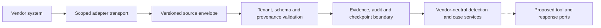

# Vendor-neutral integration framework

Wazuh is the implemented reference integration. The common interface and other product adapters below are proposed. Keep protocol details in adapters, with central enforcement of tenant and disclosure policy.

Define three distinct ports. A collector reads bounded pages, a lookup adapter returns policy-admitted observations, and a response adapter executes approved typed actions. Each advertises capabilities, supported schema versions, cancellation and rate limits. An adapter cannot set the trusted tenant, grant itself capabilities or commit a cursor independently of the core acceptance rule.

Use opaque cursor state, scoped credentials, explicit timeout and retry classes, versioned mappings and idempotency keys. Bound concurrent work by tenant and connector, contain failure to the affected integration, and use circuit breaks and backpressure rather than global retries. Audit connection scope, disposition, hashes and progress without echoing payloads or secrets. Put vendor behavior under fixture-based contract tests. The [integration index](../integrations/overview.md) links normalized data contracts and vendor plans.
