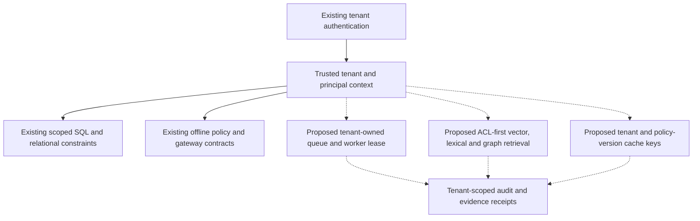

# Multi-tenant boundaries

Today the API authenticates a tenant API key and scopes relevant reads and writes by the resulting principal. The evidence, audit, integration, checkpoint and lease models define tenant-aware relationships. The current operational app boundary relies on application predicates and database constraints. B4 proposes staged forced RLS within the source registry, with default-deny activation gates. [Identity code](../../services/api/app/iam/auth.py) · [Database roles](../security/database-roles.md) · [B4 gates](../security/source-registry-migration-gates.md)

For new code derive tenant from authenticated context. Never authorize from a payload field, vector metadata supplied by a caller, an index name or a case identifier alone. Carry tenant ownership in job claims, cache keys, graph traversal, embeddings, queues, result references and exports. Include policy and authorization epochs in cache invalidation. Enforce read and write controls on all persistence paths, including administrative and background paths. Add independently verified PostgreSQL RLS where suitable and scope database roles to their actual duties.

Use deny-by-default RBAC for coarse capabilities and ABAC for tenant, resource, sensitivity, workflow stage and approval. Test mismatched identities, missing tenant filters, boundary-crossing joins, revoked grants, stale indexes and cache collisions. Test restore, reindex and migration workflows against two tenants and a denied control. MSSP operations require explicit delegated scope and reviewable cross-tenant reporting rules. [Deployment models](deployment-models.md)
