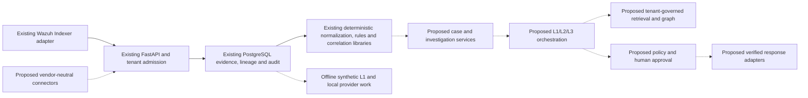

# Architecture overview

AI SOC Team combines deterministic security services and specialized local AI analysts. The authoritative path begins in tenant-authenticated ingestion and preserves evidence, lineage and audit integrity. The analytic path consumes bounded, policy-admitted snapshots and returns proposals. The execution path is a future, separate authorization boundary.

Solid arrows show implemented interfaces or libraries, with no implication of a live evaluation in this documentation review. Dotted arrows show proposed deployment wiring or offline work. The [current state](current-state.md) describes the actual boundaries. The [target architecture](target-architecture.md) defines the future service responsibilities.

Identity, provenance, configuration/version pinning, observability and audit span each layer. Deny access when tenant, policy, data provenance or authorization cannot be verified. Tool results and retrieved text are data. An analyst process cannot grant itself access or execute actions. Operate deterministically when inference is unavailable.
