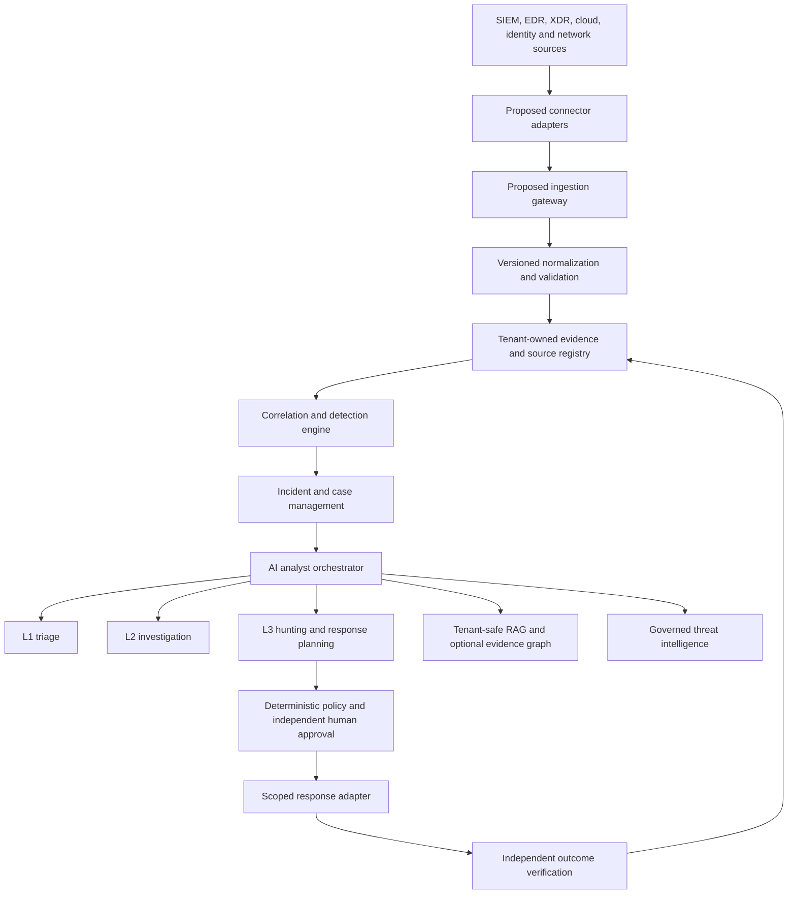

# Target architecture

This reference design is proposed. The [current state](current-state.md) defines deployed and offline boundaries.

| Plane | Responsibility |
|---|---|
| Collection | Authenticate connector identity and tenant scope before acquisition. Persist raw evidence and provenance, then normalize and advance durable cursors under a consistent acceptance rule. |
| Investigation | Build case timelines from qualified evidence, maintain alternatives and handoffs, and support deterministic correlation when AI is unavailable. |
| Knowledge | Version source rights, metadata, tenant access and freshness; expose bounded retrieval and independently verifiable citations. |
| Execution | Validate typed proposals with policy and approval. Dispatch only through least-privilege adapters and reconcile outcomes. |
| Platform | Authentication and authorization, tenant boundaries, audit and custody, model/version management, observability, backups, evaluation and configuration review. |

Keep the backend contracts stable before building a workbench. A single organization can operate a smaller deployment. Shared service and MSSP deployments require independently verified isolation across databases, queues, indexes, credentials and operator workflows. [Deployment models](deployment-models.md)
