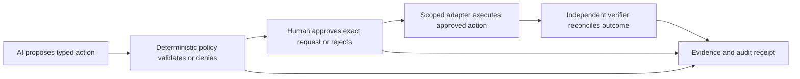

# SOAR and response adapters

Proposed. Shuffle is a candidate first adapter. TheHive and Cortex, Splunk SOAR, Cortex XSOAR, Tines and other approved workflow products are candidates. Separate case or analyzer capabilities from workflows that modify external systems.

Register a versioned playbook and action schema with allowed target kinds, effect classification, execution identity, input constraints, dry-run capability and output verifier. Bind approval to canonical parameters, resource and tenant scope, snapshot, playbook version, approver, expiry and replay policy. Gate replays and revoked approvals before dispatch. Require independent human approval for high-impact effects. Keep proposing, approving, executing and verifying identities separate.

Dry runs describe expected effects without external mutation. Bound execution with timeouts and use idempotency keys when supported. Record the external receipt and reconcile intended versus observed state using a separate read-only verifier. An unknown result enters reconciliation. Compensation requires reviewed semantics and separate approval where destructive or outside the original scope. Keep original failures and all transitions in audit.

Start with an offline no-op action and fake adapter. Require zero policy-bypass cases, explicit expiry/replay denial, and faithful failure receipts before integration testing. A model never receives live execution credentials or dispatch authority.
