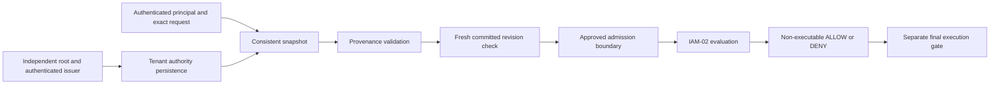

# IAM-03C authority persistence schema design

Design only, 2026-11-14. Operational authority remains **NO-GO**.
All `iam_*` names below are **proposed**, not existing tables. No DDL, application,
contract, migration, credential, security configuration or Git-index change is made.
Related deliverables: [threat model](iam03c-authority-threat-model.md) and
[isolated verification plan](iam03d-isolated-verification-plan.md).

## 1. Executive summary

Persist explicit tenant-bound assignments and immutable scopes; keep role/action
eligibility in the existing canonical IAM-02 policy. Bind every authority mutation
to one serialized tenant revision, independently authenticated issuer evidence and
the existing audit chain. Use composite FKs and tenant-specific database privileges
with RLS, not application filters alone. Snapshot reads are coherent observations;
a fresh revision comparison is necessary but does not authorize execution.

For same-database protected writes, the proposed final gate holds the same tenant
lock used by authority writers until commit. A committed revocation excludes later
successful operations based on the revoked authority. It does not cancel work
already ordered before that revocation, undo remote effects, or protect against a
malicious database administrator restoring a complete older database image.

Core tables and transaction rules are specified below. **Implementation readiness
is NO-GO pending D01–D04 in section 13.** In particular, this repository does not
establish a production trust anchor, rollback-resistant witness, non-API-key
identity source or production bridge contract. These are decisions requiring
approval, not facts that a migration can manufacture.

## 2. Existing implementation assessment and conflicts

Established from current source, not a live database:

| Evidence | Established behavior / limit |
| --- | --- |
| `services/api/app/iam/contracts.py:93`, `:238`, `:291`, `:360`, `:452` | Finite validity, exact scopes, independent issuance digests, graph validation and independent human approval; no persistence/authenticity mechanism |
| `services/api/app/iam/policy.py:25`, `:85`, `:207`, `:258` | Ten role mappings, 34 exact permissions; assignment/resource/policy intersection; explicit independent verification; no inheritance or implicit grant |
| `services/api/app/iam/admission.py:203`, `:245`, `:253`, `:275` | Synthetic provenance only; key UUID equals service principal UUID; snapshot <=60s, revocation observation <=15s; only API-key admission |
| `services/api/app/iam/authority_provider.py:21`, `:156`, `:171` | Ten component epochs, exact synthetic provider gate, pre/post checks; no operational origin verifier |
| `services/api/app/iam/postgres_authority.py:67`, `:71`, `:96`, `:113`, `:136` | False currency, exact identity/request/observation/row checks; no complete snapshot; dedicated rollback; caller closes |
| `services/api/app/database/models.py:25`, `:215`, `:263` | Tenant identity, key ownership/revoked_at, existing audit; no IAM graph or authority generation |
| `services/api/app/audit/integrity.py:123` | Locks tenant FOR NO KEY UPDATE, hashes/stages/flushes audit in caller's transaction; no commit |
| `services/api/app/database/roles.py:11`, `:68`, `:101` | Eight-table role plan, shared runtime role, limited locking-column UPDATE; only existing database names accepted |
| `services/api/app/db.py:6`, `:14`; `services/api/app/models.py:1`; `migrations/env.py:16` | Canonical engine/session stays in app.db; models compatibility export; migrations use canonical metadata |

The nine revision sources create tenant/evidence/key/audit/Wazuh storage, not the
proposed authority tables. Composite tenant FKs already exist for lineage and
Wazuh checkpoints/leases. Later Wazuh revisions deliberately refuse destructive
automatic downgrade. Audit trigger and chain migrations establish append-only and
per-tenant sequence constraints; this design neither reruns nor alters them.

Documentation conflicts/limits identified explicitly:

- IAM-01/02/03A/03B docs use older flat filenames. Current canonical code lives in
  `app.iam`; flat modules are compatibility exports, not another implementation.
- REF-01H2's 1,892/358 counts predate IAM-03C-FIX's 1,936/402. Readiness section 14
  is the later implementation record; the old counts are historical, not failures.
- `docs/security/database-roles.md` describes previously observed live privileges
  and revisions. No current deployed privilege/revision fact is inferred here.
- AGENTS.md requires database tests on `ai_soc_test`; this milestone's explicit
  future-environment requirement excludes both `ai_soc` and `ai_soc_test`. The plan
  follows the specific request, records the conflict and requires a separately
  approved, dedicated target guard. Existing guards/RolePlan cannot be reused by
  bypassing their checks. No database is accessed under either instruction.
- Current records are SYNTHETIC / TEST ONLY and the bridge admits exact synthetic
  types. A schema cannot make them operational. D04 must approve a production
  provenance boundary without relabeling synthetic fixtures as trusted sources.

## 3. Authority data model and grant choice

| Approach | Benefit | Cost / security consequence | Decision |
| --- | --- | --- | --- |
| Mutable direct grants and role-permission mapping tables | Independent custom grants | Duplicates IAM-02 mappings; risks divergence/bypass; requires contract/policy extension | Rejected for v1 |
| Approved canonical IAM-02 policy + explicit role assignments + immutable permission scopes | Reuses evaluator and exact permission vocabulary | Must pin policy content digest and revision its approval/replacement | **Selected** |

`iam_scope_actions` holds explicit assignment scope permissions, not an alternate
role-policy mapping. Effective authority is the intersection of current principal,
tenant, role, assignment, scope, resource, team membership, classification and
approved canonical policy, with independent approval where required. Tenant/key
ownership, proposed role catalogs, analyst tier and role names alone grant nothing.

Roles use exactly `contracts.RoleID`; actions exactly `contracts.Permission`;
resource types/classifications use the existing literals. Future migration source
must render explicit CHECK lists from a reviewed contract snapshot and test parity.
Unknown values, wildcard actions and unsupported policy versions deny. Role
creation means enabling one existing canonical role in a tenant, never defining a
new role or changing its permissions. Policy content remains code, but is usable
only if its digest is independently approved and matches the tenant's active pin.

The initial request authentication path remains API_KEY_SERVICE with
`principal_id = api_key_id`. HUMAN/SYSTEM_SERVICE issuer and human approver records
need independent operator/workload/session identity verification (D02). Storage
can represent all four existing kinds; representing one does not authenticate it.

The read and write trust paths meet only at verified persistence; the requester
never becomes the issuer by passing an issuer field:



## 4. Proposed schema specification

Notation is a specification, **not executable SQL**. All UUID object identities
are tenant-local; no deletion/reuse is allowed. `T` below means tenant_id UUID NOT
NULL referencing existing tenants(id), present in **every proposed table**.
`C` means created_revision and last_changed_revision BIGINT NOT NULL, both
FK `(T, revision)` -> iam_authority_revisions, with
`1 <= created_revision <= last_changed_revision`. Immutable rows have equal C.
Set/junction rows inherit their parent's creation revision and immutable lifecycle.

`V` means valid_from/valid_until TIMESTAMPTZ NOT NULL, valid_from < valid_until;
revoked_at TIMESTAMPTZ and revocation_id UUID both nullable or both nonnull,
revoked_at >= valid_from, FK `(T,revocation_id)` -> iam_revocations.
Windows are half-open. No default ACTIVE, approved issuer, grant or unbounded
validity is supplied. Timestamps supplement revision/state; they never prove currency.
`D` means lowercase hexadecimal SHA-256 length 64, checked by format and recomputed
from the canonical object it names. A well-formed D is not evidence of trust.

| Proposed table | Primary key and columns beyond T | Relationships / checks |
| --- | --- | --- |
| iam_authority_heads | PK T; revision BIGINT initially 0; epoch UUID nullable; incarnation UUID; tenant_status ACTIVE/SUSPENDED initially SUSPENDED; source_id, provider_id, snapshot_issuer_id, verifier_id, policy_digest D nullable; root_manifest_digest D nullable | Revision 0 has null authority pins/epoch; usable ACTIVE state requires revision>=1 and every pin. Composite head `(T,revision,epoch)` FK to revisions, plus typed object/principal/policy references below. One source/provider per tenant. Incarnation only accepted if externally approved; never a currency substitute |
| iam_authority_revisions | PK `(T,revision)`; epoch UUID; previous_revision nullable; operation_id UUID; mutation_kind constrained command label; actor_id/issuer_id nullable only for externally approved bootstrap; source_id UUID; policy_digest D; mutation_digest D; previous_event_digest D; event_digest D; root_manifest_digest D; signer_key_id; signature BYTEA; created_at; audit_sequence BIGINT; audit_entry_hash D | UNIQUE `(T,epoch)`, `(T,revision,epoch)`, `(T,operation_id)`; revision>=1, previous_revision=revision-1 except first is null; self FK on previous revision; epoch typed object FK; actor/issuer principal FKs; source typed FK; policy approval FK; `(T,audit_sequence)` FK existing audit_logs(tenant_id,sequence_number), all deferred where bootstrap needs it. Ledger is append-only; signature verifies the specified event content, not its own key |
| iam_objects | PK `(T,object_id)` UUID; object_kind; C | Tenant-wide UUID collision/reuse barrier; UNIQUE `(T,object_id,object_kind)`. Kind in SOURCE, PROVIDER, PRINCIPAL, ROLE, POLICY, TEAM, SCOPE, MEMBERSHIP, ASSIGNMENT, RESOURCE, ISSUANCE, REVOCATION, APPROVAL, REVISION. Deferred typed-subtype integrity checks; source/provider are registry-only identities bound to signed manifest/head |
| iam_principals | PK `(T,principal_id)`; kind; authentication_method; authentication_reference UUID; status ACTIVE/SUSPENDED/REVOKED; analyst_tier nullable; V; C | Typed PRINCIPAL FK; existing kind/method/tier consistency; REVOKED iff V revoked. External reference is a tenant-qualified, signed opaque authentication assertion, not a fabricated FK to a nonexistent session table. API_KEY_SERVICE binding below is additionally required |
| iam_api_key_bindings | PK `(T,principal_id)`; api_key_id UUID; C | Principal FK, `(T,api_key_id)` FK existing tenant_api_keys; principal_id=api_key_id; principal kind API_KEY_SERVICE and authentication reference equal key ID. Requires additive existing key UNIQUE(tenant_id,id), absent today. No raw key/hash copied |
| iam_roles | PK `(T,role_code)`; object_id UUID; status ACTIVE/DISABLED; C | Typed ROLE FK; role_code exact RoleID; UNIQUE `(T,object_id)`. No arbitrary permission/inheritance column; creator derives from creation revision audit |
| iam_policy_approvals | PK `(T,policy_digest)`; object_id UUID; policy_version; V; C | Typed POLICY FK; version 1.0 only initially. Digest must match approved code policy and signed root/control-plane approval. No mutable copy of role/action mapping |
| iam_issuers | PK `(T,issuer_id)`; source_id UUID; public_key_id; public_key BYTEA; anchor_manifest_digest D; V; C | Issuer FK principals, typed SOURCE FK; HUMAN/SYSTEM_SERVICE only, active/unrevoked; root manifest independently authorizes exact key/tenant/source/identity/scope. Key fields are public verification material; private keys never stored here |
| iam_issuer_scopes | PK `(T,issuer_id,record_type)`; created_revision BIGINT | Issuer FK; record_type exactly SNAPSHOT, VERIFIER, ROLE_ASSIGNMENT, TEAM_MEMBERSHIP, TEAM_SCOPE or APPROVAL; signed manifest bounds each scope. Issuing authority is separate from ordinary IAM roles |
| iam_issuer_roles | PK `(T,issuer_id,role_code)`; record_type fixed ROLE_ASSIGNMENT; created_revision BIGINT | FK issuer_scopes `(T,issuer_id,record_type)` and roles `(T,role_code)`; explicit ceiling on assignable canonical roles. No missing-list-means-all behavior |
| iam_teams | PK `(T,team_id)`; purpose; active BOOLEAN; C | Typed TEAM FK; purpose exactly existing Team.purpose literals. Deactivation revokes/invalidates associated membership authority atomically |
| iam_scopes | PK `(T,scope_id)`; team_mode; authorization_receipt_id nullable; C | Typed SCOPE FK; mode exact TeamScope modes; expanded scope requires TEAM_SCOPE receipt, ASSIGNED_TEAM has no receipt. Immutable content; changes allocate a new scope |
| iam_scope_actions | PK `(T,scope_id,action)` | Scope FK; exact Permission; nonempty per scope, <=34; no wildcard |
| iam_scope_resource_types | PK `(T,scope_id,resource_type)` | Scope FK; exact ResourceType; nonempty <=16; all actions' categories must be included |
| iam_scope_classifications | PK `(T,scope_id,classification)` | Scope FK; exact classification; nonempty <=4; no ordering/inheritance |
| iam_scope_teams | PK `(T,scope_id,team_id)` | Scope/team FKs; ASSIGNED_TEAM exactly one, EXPLICIT_TEAMS 1–16, ALL_TENANT_TEAMS zero; deferred aggregate checks |
| iam_memberships | PK `(T,membership_id)`; principal_id, team_id, receipt_id, issuer_id; policy_reference; V; C | Typed MEMBERSHIP and principal/team/receipt/issuer FKs; issuer!=subject; exact matching TEAM_MEMBERSHIP receipt. One unrevoked assignment per principal/team; expiration handled explicitly before replacement |
| iam_role_assignments | PK `(T,assignment_id)`; principal_id, role_code, scope_id, receipt_id, issuer_id; policy_reference; V; C | Typed ASSIGNMENT and principal/role/scope/receipt/issuer FKs; issuer!=subject; exact ROLE_ASSIGNMENT receipt; UNIQUE unrevoked `(T,principal_id,role_code,scope_id)`; issuer role ceiling mandatory |
| iam_resources | PK `(T,resource_id)`; resource_type, classification, owner_id, team_id nullable, assignment_id nullable; evidence_id, integration_id, role_code, team_target_id, principal_target_id all nullable; C | Typed RESOURCE and principal/team/assignment FKs. Exactly one backing column: evidence_id->existing evidence_records, integration_id->existing wazuh_integrations, role_code->iam_roles, team_target_id->iam_teams, principal_target_id->iam_principals, each composite with T. CHECK resource_type matches evidence/integration/role/team/user respectively. Evidence/integration resource_id equals backing ID. Other resource types deny until a resolver/schema extension is approved; no invented backing tables |
| iam_resource_scopes | PK `(T,resource_id,scope_id)` | Resource/scope FKs, 1–32 per resource, immutable/versioned change through command; exact type/classification/team compatibility checked |
| iam_issuance_receipts | PK `(T,receipt_id)`; subject_id, subject_kind, issuer_id, purpose; record_digest D; source_id; policy_reference; signer_key_id; signature BYTEA; V; C | Typed ISSUANCE, subject typed-object/principal/source FKs; purpose ROLE_ASSIGNMENT->ASSIGNMENT, TEAM_MEMBERSHIP->MEMBERSHIP, TEAM_SCOPE->SCOPE. UNIQUE `(T,purpose,subject_id)` per immutable issuance; record_digest is exact IAM-01 issued-contract digest. Signed envelope includes tenant/source/purpose/subject/issuer/content/window/creation revision |
| iam_revocations | PK `(T,revocation_id)`; target_id UUID; revoked_at; revision BIGINT; actor_id, reason_code; C | Typed REVOCATION, target typed-object/principal/revision FKs; UNIQUE `(T,target_id)`; fixed sanitized reason vocabulary approved with command implementation. Tombstones never deleted; no UUID reuse |
| iam_approvals | PK `(T,approval_id)`; operation_id, requester_id, executor_id, resource_id, action, parameters_digest D, approver_id, issuer_id; policy_reference; operation_digest D, resource_digest D, approver_digest D; operation_canonical BYTEA, approver_canonical BYTEA; outcome; signer_key_id, signature BYTEA; V; C | Typed APPROVAL and principal/resource/issuer FKs; approver=issuer, HUMAN, distinct from requester/executor; requester=executor for current IAM-02. Exact ApprovalRecord outcome/revocation constraints; bounded canonical artifacts described below |

There are **23 proposed tables**: one head, one revision ledger, one typed identity
registry, thirteen record tables and six scope/membership-limit relationship sets
plus resource-scopes as enumerated above. The table inventory itself is authoritative;
no unspecified generic grant table is assumed.

Every subtype ID references iam_objects with its fixed kind: implement a fixed-kind
CHECK column and composite FK `(T,id,kind)` to the registry's unique triple.
The registry is necessary because RevocationState references and current bridge
checks compare UUIDs across categories without a type tag. The key-service
principal/API-key ID equality is an explicit alias, not two conflicting registry
kinds. Reject collisions between unrelated principals/resources/epochs. Registry
SOURCE/PROVIDER entries have no separate subtype; all other kinds require their
listed row (REVISION uses revisions.epoch). Constraint triggers verify this at commit.

### Canonical artifacts and receipt cycles

Mutable authority relationships stay normalized. The two approval BYTEA fields
are immutable historical proof artifacts, not independently writable graph copies:
canonical ProposedOperation includes the exact resource metadata as approved;
canonical PrincipalIdentity captures the exact approver then bound. Recompute
all three digests, compare reconstructed live approver/resource/operation, and deny
on any difference. Each artifact <=64 KiB; bounded aggregate size enforced before
parsing. No credential/prompt/raw evidence/free text is stored in authority records.
Other structured fields reconstruct the exact original approval; changed approvals
or scopes are new IDs. Revocation is a retained event, not rewriting signed content.

Allocate assignment/membership/scope and receipt IDs first. Build the exact issued
contract including Provenance.record_id=receipt_id, hash it, then sign the receipt.
The receipt does not embed its own hash in the issued contract, so no hash cycle
exists. Reciprocal subject/receipt FKs and revision/object/bootstrap FKs are
DEFERRABLE INITIALLY DEFERRED, validated before commit. Deferred triggers verify
purpose, subject, issuer, policy reference and typed subtype agree. No dangling
registry-only assignment or scope may commit.

Resource backing uses explicit nullable columns so PostgreSQL can enforce real
FKs without a polymorphic unqualified target UUID. A row-level exactly-one CHECK
and type-match CHECK are required. Team/user/role authorization resources use a
separate RESOURCE UUID from the TEAM/PRINCIPAL/ROLE object they target, avoiding
registry kind collisions. The protected resolver binds that mapping and the exact
mutation target/parameters; caller resource metadata cannot override it. Evidence
and integration API resource UUIDs retain their existing backing IDs unless a
collision requires an explicit blocker. Unsupported alert/case/tool/model and
other resource resolvers remain denied, not inferred from payload JSON. D04 must
approve the exact resolver/projection contract before implementation.

## 5. Keys, constraints and indexes

Unless explicitly marked nullable in section 4, every column is NOT NULL; no
implicit state/approval defaults except suspended revision-0 heads. UUID means a
strict UUID value, BIGINT is a checked signed counter, all times are timezone-aware
TIMESTAMPTZ, boolean is BOOLEAN, enum/code fields are bounded TEXT with the stated
exact CHECK vocabulary. Policy/provenance references and public/signer key IDs
use the existing bounded IAM Identifier grammar. Proposed Ed25519 public-key and
signature BYTEA lengths are 32 and 64 respectively, with algorithm/domain version
fixed by the approved root profile (D01), never selected by an input row. Artifacts
have the explicit size bounds above. These checks do not replace signature checks.

All relationships between persisted domain rows include T, even if a UUID or digest
is independently unique. ON DELETE/UPDATE RESTRICT, no cascades and no destructive
routine deletion. Missing optional reference means SQL NULL, never a zero UUID or
another tenant's row. External session/workload IDs are opaque tenant-bound
assertions whose authenticated provenance must be verified under D02; they are not
unqualified database joins.

Required indexes, beyond PK/UNIQUE indexes: each referencing composite FK prefix;
assignments `(T,principal_id)` and `(T,role_code)`; memberships `(T,principal_id)`
and `(T,team_id)`; resources `(T,resource_type)`; receipts `(T,issuer_id)`;
revocations `(T,revision)`; revision audit link `(T,audit_sequence)` unique;
principals `(T,authentication_method,authentication_reference)`; issuer/source reads
`(T,source_id)`; optional-reference indexes only on nonnull values. Set PKs already
start with parent T/id. Use partial uniqueness WHERE revoked_at IS NULL for live
assignment/member rows; never use volatile current-time predicates in indexes.
Expired but unrevoked rows must be explicitly retired before replacement, avoiding
ambiguous overlapping grants. Validate aggregate cardinality/type links using
restricted commands plus deferred constraints, not row CHECKs that query other tables.

Existing additive prerequisites: UNIQUE(tenant_id,id) on tenant_api_keys;
UNIQUE(tenant_id,id) on a resource backing table only where not already present.
Evidence and integrations already have tenant/id uniqueness; audit already has
UNIQUE(tenant_id,sequence_number). No audit UUID FK or new audit hash format is needed.

## 6. Trust and provenance model

The **proposed external trust anchor** is an operator-controlled signed manifest,
verified by a verifier whose root public-key pin and source configuration are
outside PostgreSQL and inaccessible to the tenant/request/model/runtime reader.
Proposed signatures: a reviewed Ed25519 profile over domain-separated canonical
bytes, with explicit algorithm/version and strict length/encoding checks. This
is a proposal; there is no existing signer/verifier/key-custody implementation.
D01 must approve custody, distribution, recovery and independent rollback detection.

The manifest explicitly binds tenant, incarnation, provider/source, issuer and
verifier principal/key identities, permitted record types, role ceilings and
approved policy digests. It must authenticate those identity mappings under D02.
A DB issuer/key/status row is accepted only if it matches independently verified
manifest authority, is current/unrevoked and has correctly signed issuance/events.
A row saying ACTIVE/trusted, a matching digest or a key supplied by that same row
cannot bootstrap trust. Model/request fields cannot choose manifest paths, keys,
provider IDs, signing algorithms or source connections. No root private key in DB.

Issuer provenance permission and mutation-request authorization are separate.
Ordinary role assignment also requires an authenticated human operator authorized
for the exact IAM-02 roles.assign scope and its independent approval; teams.manage
and users.manage retain their existing human restrictions. A SYSTEM_SERVICE signer
may attest an approved command but cannot replace that human authority or approval.
Initial bootstrap, canonical-role enabling, policy and issuer trust are root-scoped
control-plane commands requiring explicit independent operator approval, not newly
invented IAM Permission values or an org_admin bypass. D02 must approve this
bootstrap-to-policy transition before such commands exist.

Ordinary grant issuance cannot change issuer/provider trust or policy approval.
Trust/role-ceiling/policy changes require independently authenticated root approval,
not a tenant role with a similar name. Bootstrap is a separately authorized control
operation creating the first rooted principals/issuers/source/policy; migration
creates only suspended revision-0 heads and no issuer or grant. Root approval is
independent of the new issuer it installs, avoiding self-issued trust.

| Boundary | Trusted inputs | Untrusted inputs / validation | Failure, audit and tenant attack |
| --- | --- | --- | --- |
| Principal authentication | Existing verified key ownership, later approved identity adapter | Header/model tenant/role/issuer claims; recheck key state | Deny mismatch; sanitized known-actor denial; tenant comes from authentication |
| Issuer/control plane | Protected authenticated operator + pinned manifest + explicit issuer scopes | Requested mutations and DB authority claims; verify signature/scope/role ceiling | Deny self-grant/unknown issuer/cross-tenant target; durable failed-attempt event when tenant is known |
| Persistence mutation | Tenant-bound DB session, reviewed restricted command | All mutation fields; lock/revision/FK/receipt/audit validation | Atomic rollback on mismatch; no revision without mutation/audit |
| Snapshot acquisition | Protected tenant/source/session and trusted evaluation time | Raw DB rows; exact shapes, bounded complete graph, signatures | No partial/default authority; sanitized categorized denial |
| Freshness | Fresh committed head and approved incarnation/root anchor | Old epoch, timestamps and caller revision | Deny mismatch/unavailable verification; epoch alone not execution capability |
| Admission/policy | Protected verified production adapter approved under D04 | Request/action/resource/approvals | Existing validators and exact IAM-02 checks; emit sanitized decision metadata |
| Execution | Fresh final gate, exact operation and independent approvals | Replayed ALLOW or altered resource/parameters | Fail before side effect; audit atomically for DB actions; cross-tenant references never resolve |

DB authentication is not authorization of an application principal. A shared
server role, valid API key or authorized issuer's existence does not grant an
operation to the requester. A compromised trusted signer/writer remains a trust
boundary failure; trusted DB administrators can deny service or remove evidence.
Signatures alone cannot prove query completeness or prevent replay of an entirely
old valid graph. D01 must resolve the rollback threat instead of claiming it solved.

## 7. Persistent revisions and revocation

A tenant's BIGINT revision advances exactly once per effective command, under its
tenant lock and locked head. Never wrap, reset or reuse; overflow denies and stops
writes. A repeated operation_id with the same verified digest returns its recorded
outcome without another change; a different digest for that ID denies. The intent
digest binds immutable target/content/parameter IDs and excludes retry transport
metadata; the signed event additionally binds the actual expected/next revision.
Retries preserve intent IDs, revalidate current authorization, and never reinterpret
a previously committed operation ID as a different command. Revocation
of an already revoked target is an audited no-op attempt, not a fresh grant.

The ledger event digest covers canonical event metadata, mutation digest,
previous event digest, epoch/counter and the returned audit sequence/entry hash;
it excludes its own event_digest and signature. First revision uses a fixed
non-authoritative genesis previous digest; later rows must bind the prior signed
event exactly. Audit details contain mutation digest and revision IDs, **not the
ledger event digest**, avoiding a circular audit/ledger hash dependency.

Each committed change inserts one revision ledger row with a persistent UUID epoch,
updates the head to that `(revision,epoch)` and records every affected row's C/
revocation event. UUIDs are opaque handles to persistent rows, not random evidence
of freshness. Ten component epochs and RevocationState.state_id may use the same
persisted revision epoch after D04 approves their production representation.
Source/incarnation pins and restored-head transitions require D01 approval; no
new head can claim its own trusted origin. Provider is tenant/source-bound: `is_current(epoch)` must look up that exact
persisted epoch under its bound tenant and compare with a **fresh committed** head,
approved incarnation and trusted manifest; unknown/invalid/stale values deny.
No process-local epoch registry or timestamp-only currency is permitted.

Key, principal, tenant, role, scope, team, membership, resource, issuer, provider,
policy, receipt and approval changes all participate. API-key revoked_at updates
must use the same command/lock/revision path; old raw provisioning/revocation DML
cannot remain an alternate operational writer. No grant is silently removed from
history. New snapshots select exact current objects and relevant tombstones;
revoked acting/issuing identities and referenced records deny before admission.
RevocationState need not contain all historical tombstones: query all relevant
closure IDs, retain global tombstones durably, reject overflow rather than truncate.

**Immediate semantics under a trusted database and compliant writers:** after a
revocation commits, no later final gate can start/commit a same-database protected
mutation on that revoked authority. A transaction already holding the gate lock is
ordered before revocation; revocation waits for it. Thus revocation latency includes
bounded in-flight lock holders. Validity deadlines are checked at final gate/start;
there is no promise to undo earlier work or cancel computation when time expires.
Revocation/expiry are separate checks; a generation is not proof of unexpired time.
If “immediate” means cancellation of already-running external work, that requirement
is **unsupported**, and such actions remain denied pending IAM-04 design.

## 8. Transaction and concurrency design

| Isolation | Use / reason |
| --- | --- |
| READ COMMITTED | Authority mutation and final execution gate: lock tenant first, then obtain fresh current rows after waiting; never trust an earlier statement's view |
| REPEATABLE READ, READ ONLY | Dedicated adapter snapshot: coherent graph across bounded SELECTs; cannot row-lock and cannot observe later commits as currency |
| SERIALIZABLE | Optional verification variant, not a replacement for common locks; retryable aborts still possible and no atomicity across external systems |

Global lock order for one-tenant operations: **existing tenants row FOR NO KEY
UPDATE -> authority head FOR UPDATE -> authority/domain rows in stable ID order
-> audit tail via existing writer**. The audit writer reacquires the already held
tenant lock. No upgrade from a weaker tenant lock; no child/key row lock before
tenant acquisition. Multi-tenant commands are unsupported. This intentionally
serializes tenant-protected writes/audit; bound transaction/lock duration and deny
on timeout. Different tenants use different tenant/head rows.

Proposed command entry functions, owned by a NOLOGIN authority owner, have fixed
schema-qualified references/search_path, no dynamic SQL, tenant binding and no
PUBLIC EXECUTE. Tenant command wrappers bind a fixed approved tenant and the
authenticated session_user/login capability; SECURITY DEFINER current_user is the
owner and must never be mistaken for the caller. Binding comes from protected
provisioning configuration, not a caller-set role/GUC or editable tenant row.
Root wrappers still require a signed root intent for the exact target tenant.
The per-tenant writer has EXECUTE only, not arbitrary authority DML. Functions acquire/check the tenant lock first even if a caller omitted it.
Root-only functions handle trust/policy bootstrap and key/tenant revocation paths;
ordinary assignment functions check exact signed issuer ceilings. Harden and audit
these proposed SECURITY DEFINER functions before implementation (D03). They do not
reimplement the existing audit hashing algorithm.

Mutation pseudocode — transaction shape only, not executable migration:

```text
BEGIN READ COMMITTED; bounded timeouts
  acquire tenant NO KEY UPDATE lock, then head UPDATE lock
  authenticate actor/root or issuer, validate exact command/expected revision
  resolve operation_id; reject conflict; verify canonical signature and role ceiling
  stage existing record_audit_event(...) for revision r+1 and mutation digest
  invoke restricted command with that audit sequence and expected r
    -> recheck tenant/head/signature binding; write records + tombstones
    -> append ledger(r+1, epoch, audit_sequence); set head(r+1, epoch)
  deferred checks: all affected rows/revision/event/audit links agree
COMMIT all, or ROLLBACK all
```

After the unchanged audit writer returns sequence/entry hash, the protected
local signer binds them into the ledger event before the command writes it. No
unbounded signing/network call is allowed under the lock. The command checks
audit tenant/actor/action/resource/sanitized mutation digest, entry hash and revision
metadata. Deferred checks disallow mutation/revision rows lacking the audit link;
only a trusted audit-emitting control plane can call these commands. The existing
Python writer computes/stages hashes in the same connection/transaction before the
command. An intent audit committed without a mutation is not evidence of success;
the ledger identifies successful changes. No new DB hash function copies the writer.

Serialization/deadlock failures abort the entire transaction. Bounded retry only
for explicitly retryable categories, using the same operation_id but newly read
state and reauthorized exact intent. No retry of a stale ALLOW, provenance failure
or uncertain remote action. If connection is lost during commit, outcome is UNKNOWN:
read the durable operation_id/ledger/audit under a new authenticated connection;
never assume rollback or issue a second effective command without reconciliation.

For ordinary snapshot reads: caller opens dedicated read-only repeatable-read
transaction; adapter reads/checks all components, then existing adapter cleanup
rolls it back and caller closes. Currency uses a separate fresh read, never that
same repeatable-read transaction, replica-lagged source or cached observation.

For a protected same-DB write: a **separate final execution gate** in a caller-owned
READ COMMITTED write transaction takes the tenant lock, reauthenticates/re-reads
key + head + full relevant graph, revalidates exact request/resource/policy/approval
and trusted time, evaluates IAM-02, performs business change and existing audit,
and holds the lock until commit. Reuse the future pure row-to-contract assembler;
never call today's rollback-owning `read()` inside that business transaction.
If the observed epoch changed, discard the old decision and perform a full new
admission/policy check, or deny. No permission transfers through a cached ALLOW.

Queued/external actions get no reusable authority from enqueue-time validation.
They remain unsupported here. A future executor must revalidate at dispatch and
provide resource-side fencing/idempotency and explicit in-flight revocation
semantics. A DB outbox or a last-second revision check alone cannot atomically
revoke an already dispatched remote effect; absence of such a protocol denies.

## 9. Tenant isolation and database privileges

Composite FKs prevent cross-tenant persisted relationships even under erroneous
inserts. They do not constrain SELECT results. Proposed authority tables therefore
require RLS with FORCE ROW LEVEL SECURITY for ordinary roles, plus explicit
application tenant filters, exact-row validation and restricted column projections.

Use tenant-specific reader/writer/executor login capabilities with no ownership,
SUPERUSER, BYPASSRLS, other-tenant membership, role administration or schema CREATE.
Policies TO those exact roles use a fixed approved tenant UUID; do not trust a
client-set GUC such as app.tenant_id as the sole policy identity. Tenant provisioning
of roles/policies is an explicit privileged operation; pool connections cannot
switch into other tenants. A malicious tenant UUID parameter cannot change policy.
The deployment owner remains trusted and separate; RLS cannot restrain superusers.

Reader: SELECT needed authority columns only, no key hashes, raw evidence, DML,
lock-column UPDATE or SECURITY DEFINER write EXECUTE. Reader snapshots are read-only.
Writer: tenant-bound command EXECUTE and existing narrowly scoped tenant/audit
writer privileges, no direct authority DML; root commands require a separate
protected capability. Executor: only tenant-scoped business privileges and exact
read access needed by the final gate, not grant mutation. Revoke PUBLIC/default
inherited privileges. NOLOGIN owners and migrators never serve API requests.

Existing shared runtime roles do not automatically receive new-table grants.
Authority RLS must be exercised with real nonowner logins, not only administrator
SET ROLE sessions. Existing auth's cross-tenant key-hash lookup remains a separate
protected identity operation; it must not make the authority reader global.
Public API authentication is unchanged by this design.

## 10. Audit and evidence integration

Use existing record_audit_event and existing per-tenant sequence/hash chain, without
changing hash inputs, trigger semantics, writer locking or transaction ownership.
Revision.audit_sequence references the existing tenant/sequence uniqueness, not a
new parallel audit log. Audit sequences include denied attempts and unrelated events, so they need not
equal authority revisions. Source/signature digests are consistency/provenance fields,
not replacements for audit hashes. Authority records never rewrite evidence,
evidence hashes, lineage or ingestion checkpoints.

| Proposed event label | Required sanitized details | Transaction |
| --- | --- | --- |
| iam.role.created / iam.role.disabled | role code/object, issuer/actor, policy digest, before/after revision, operation ID | Same authority mutation transaction |
| iam.role.assigned / iam.role.revoked | subject/assignment/scope, issuer, source, policy/content digest, revisions | Same transaction; revoke tombstone retained |
| iam.scope.replaced / iam.policy.approved / iam.policy.revoked | old/new IDs/digests, affected scope/policy, root approval reference | Same transaction; no duplicated direct grants |
| iam.issuer.trust_changed / iam.provider.trust_changed | exact root manifest digest/key ID, subject, changed scope, revisions | Same root-authorized transaction |
| iam.authority.changed | mutation digest, before/after revision, operation ID, mutation kind | One successful event may use a specific label above with revision metadata; no obligatory second hash entry |
| iam.authority.change_denied / iam.authority.change_failed | known authenticated actor/tenant, stable reason, operation/correlation ID; no untrusted payload | After rollback in an independent audit-only transaction if tenant/actor known; no authority revision increment |

Human control-plane attribution uses existing actor_type='service' for the
verified emitting control-plane service principal, with independently authenticated
human principal reference and signed operator intent digest in bounded details.
Do not mislabel a human as an API key or add an unsupported 'human' actor_type.
D02 must approve this attribution/delivery boundary. Unknown tenant/actor failures
must not write into a tenant named only by an attacker; use sanitized protected
operational logging. If durable audit is unavailable, stop authority mutation;
failed-attempt persistence cannot be promised during complete DB failure.

## 11. Migration sequencing — no executable migrations

1. Approve D01–D04, inventory actual future target/dependencies/ownership/indexes,
   audit protections, lock privileges and recovery. Do not infer current DB state.
2. Add only required tenant/id uniqueness to existing key/backing tables, validate
   no duplicates/ownership violations. Review index/constraint lock impact.
3. Create suspended revision-0 heads and relational tables. Add deferred cyclic
   FKs/triggers after referenced tables exist; install append-only ledger/tombstone
   protection and cardinality/receipt/audit consistency constraints. No auto grants.
4. Create explicit new-table privilege/RLS/command-function plan; existing role
   generator's revision/table inventory requires a separately reviewed update.
   No automatic default grants or privileged login cutover.
5. Backfill only inert tenant/head identity by default. Create no principal/key
   binding without separately approved authenticated enrollment and explicit finite
   validity; never guess ACTIVE or invent validity from key creation time. Existing
   keys receive no roles, memberships, active policy pin or trusted issuer. A later
   approved principal enrollment may start SUSPENDED with finite validity and no
   grants. Existing API behavior remains unchanged.
6. Separately authorize rooted enrollment/bootstrap and signed policy/issuer
   provisioning. Migration never invents provenance. Only then can commands issue
   explicit scopes/assignments to separately authenticated identities.
7. Verify isolated migration/constraint/privilege/audit/concurrency/recovery tests.
   Implement protected provider/production bridge only after D04 approval and
   isolated evidence; keep is_current false and existing bridge gate until then.
8. Subsequent separately authorized IAM-04 integrates execution gates. No model,
   Wazuh or operational deployment is implied by schema installation.

Recovery: disable new consumers/mutation EXECUTE and retain additive tables,
revocations, revisions, signatures and audit history. No automatic DROP/downgrade,
role deletion, generation reset, regrant or audit backfill/re-hash. Application
rollback cannot make a revoked grant valid. Restore/incarnation changes require
D01 external trust/rollback protocol; restoring an old DB is not a safe revocation
rollback. Rehearse recovery without destructive cleanup in the future approved lab.

## 12. Adapter implementation contracts — future only

Current `read(authenticated, request, *, at)` inputs remain protected principal
object, checked request, trusted aware time, tenant/principal context, independently
pinned source and dedicated injected read session. Caller/request cannot select
DB endpoint, authority tenant, issuer keys, policy body, revision or verification flag.
Current identity SELECT shapes remain `(id)` and `(id,tenant_id,revoked_at)`.

Future projected row groups are explicit projections of table columns in section 4:
head = `(tenant_id,revision,epoch,incarnation,tenant_status,source_id,provider_id,
snapshot_issuer_id,verifier_id,policy_digest,root_manifest_digest)`;
principal/assignment/member/resource/scope/receipt/issuer/revocation groups project
exact named contract columns plus their T/C/V/provenance fields; normalized sets
project their listed full PK only. Revision proof projects the complete ledger row
including audit linkage. Key hashes and private/secret material are never projected.
Exact multi-row projections (common V expands to valid_from, valid_until,
revoked_at, revocation_id; C expands to created_revision, last_changed_revision):

| Group | Exact projected column tuple, followed by expanded common columns |
| --- | --- |
| Principal | `(tenant_id,principal_id,kind,authentication_method,authentication_reference,status,analyst_tier)` + V + C |
| Binding | `(tenant_id,principal_id,api_key_id)` + C |
| Role | `(tenant_id,role_code,object_id,status)` + C |
| Policy pin | `(tenant_id,policy_digest,object_id,policy_version)` + V + C |
| Issuer | `(tenant_id,issuer_id,source_id,public_key_id,public_key,anchor_manifest_digest)` + V + C |
| Issuer scope / role ceiling | `(tenant_id,issuer_id,record_type,created_revision)` / `(tenant_id,issuer_id,role_code,record_type,created_revision)` |
| Team | `(tenant_id,team_id,purpose,active)` + C |
| Scope | `(tenant_id,scope_id,team_mode,authorization_receipt_id)` + C |
| Scope sets | Each listed full `(tenant_id,scope_id,action/resource_type/classification/team_id)` PK, one separate query per set |
| Membership | `(tenant_id,membership_id,principal_id,team_id,receipt_id,issuer_id,policy_reference)` + V + C |
| Assignment | `(tenant_id,assignment_id,principal_id,role_code,scope_id,receipt_id,issuer_id,policy_reference)` + V + C |
| Resource | `(tenant_id,resource_id,resource_type,classification,owner_id,team_id,assignment_id,evidence_id,integration_id,role_code,team_target_id,principal_target_id)` + C |
| Resource scope | `(tenant_id,resource_id,scope_id)` |
| Issuance | `(tenant_id,receipt_id,subject_id,subject_kind,issuer_id,purpose,record_digest,source_id,policy_reference,signer_key_id,signature)` + V + C |
| Revocation | `(tenant_id,revocation_id,target_id,revoked_at,revision,actor_id,reason_code)` + C |
| Object proof | `(tenant_id,object_id,object_kind)` + C |
| Approval | All listed iam_approvals columns in listed order, preceded by tenant_id and followed by V + C |

These are group schemas, not SQL strings. No field is inferred from arbitrary
rows. Fake-session tests must reject unknown/missing columns, and query/source
signature/domain-separation changes require explicit review. Never SELECT *,
ORM lazy-load or treat unprojected hidden data as verified. Created_revision in
issuer-set projections has a composite revision FK and deferred equality to the
parent creation revision, not an independently writable value. Head/revision proofs additionally bind the exact
source/provider registration, ledger signature and audit link.

Resolve the exact request resource and complete necessary current graph closure,
including issuers and human approver authority where applicable. Principal/team
reverse references derive from exactly the current rows included. Do not load an
unbounded tenant graph; each group queries contract cap+1 and denies overflow,
missing dependencies, duplicate references, contradictory grants or truncated
results. Contract caps remain 64 principals/memberships/receipts, 32 teams/scopes/
assignments/resources, ten roles; preserve existing per-object and aggregate byte
bounds. Resource-less or unsupported backing types deny, never synthesize owners.

Reconstruct immutable scoped contracts, recompute issuance/operation/resource/
policy digests and independent signature proofs, validate relevant revocations
and finite validity, then invoke existing IAM graph/admission/policy validators
through the future protected boundary. No copying production rows into synthetic
registries or constructing trust booleans from row labels. Runtime receipt/anchor
windows are clipped to the current verified snapshot and persisted validity; clipping
never extends an expired record or reissues changed content. Signed envelope must
permit this projection explicitly under D04; do not pretend clipped data retains an
old contract signature. No trusted source/unknown issuer/approval means deny.

A dedicated fresh currency read resolves `(T,epoch)` to a persisted revision and
compares active head/source/incarnation/root manifest. It must not observe its own
old repeatable-read view. Read observations remain transaction metadata, not the
provenance verifier. Error classes remain stable/sanitized: invalid identity,
invalid request, malformed/incomplete records, unverified transaction/origin,
stale/unknown revision, read failure and cleanup failure; any new operational
category requires D04 review. Never return a partial snapshot after a failure.

Methods unchanged **now**: read boundary/rollback, is_current=False, no engine/
session creation, exact read-only supplied flag, Mapping/UUID checks and unsupported
request rejection. Future scope: implement source verification and complete row
assembly, real observer/read transaction wrapper, persistent currency comparison
and approved non-synthetic bridge. The final execution gate is distinct from this
rollback-owning reader and cannot be silently added to its protocol.

## 13. Unresolved critical decisions and approval gates

| ID | Status | Decision requiring approval / reason it cannot be inferred |
| --- | --- | --- |
| D01 | **BLOCKED** | Designate independent root-key custodian/distribution/recovery and decide DBA/restore rollback threat. Signatures do not prove absence of omitted revocations or prevent whole-image replay. Either explicitly accept a trusted-DBA boundary with separately controlled restores or approve an external monotonic witness/state-completeness protocol. No such witness exists; do not claim atomic witness+DB commit or immediate revocation under DBA compromise |
| D02 | **BLOCKED** | Approve authenticated operator/HUMAN/SYSTEM_SERVICE identity delivery and bootstrap/audit attribution. Existing public bridge authenticates API keys only; roles and DB rows cannot authenticate an operator or human approval |
| D03 | **BLOCKED for execution** | Approve dedicated disposable database name/guards and tenant-specific RLS/login/SECURITY DEFINER ownership/privilege plan. Existing RolePlan/test guards accept only excluded database names; no production role change is implied |
| D04 | **BLOCKED** | Approve the production source/admission/epoch/signature/validity-projection contract. Current snapshots and bridges are deliberately synthetic-only; is_current UUID alone does not encode a monotonic counter, and audit-safe clipping of signed receipts/anchors needs exact semantics |

The proposed design chooses serialization and a precise commit-linearized revocation
contract. If the owner instead requires cancellation of running work or atomic
external side effects, that is an additional blocking IAM-04 requirement, not an
unimplemented claim of this schema. No unsupported requirement is silently waived.

## 14. Acceptance criteria and offline validation

Architecture acceptance: every persisted relation uses a tenant-qualified FK;
registered IDs cannot collide; all mandatory graph components and exact grants have
sources; independent provenance and pinned policy are required; monotonic revisions,
common writer/executor locks, audit atomicity and unknown-commit reconciliation are
specified; bootstrap/default deny and retained rollback state are explicit.
Approval of D01–D04 and real isolated tests are required before implementation GO.

Documentation consistency, schema inventory/relationship checks, input/index
preservation, in-memory compilation and the established focused offline IAM suite
are recorded in the verification plan. No DDL, SQL execution, live authentication,
PostgreSQL isolation test or key verification implementation is performed here.
Historical full regression remains 1,936 passed; it is not claimed as a fresh full
suite result for this documentation-only phase. The 214 excluded cases remain unrun.

## 15. Operational readiness assessment

The proposed relational core is reviewable but critical trust and integration
decisions are BLOCKED. Existing adapter safeguards remain byte-for-byte unchanged;
no operational snapshot can be returned and is_current remains false.

**IAM-03C-SCHEMA-DESIGN: BLOCKED — design delivered; D01–D04 require approval.**  
**SCHEMA IMPLEMENTATION READINESS: NO-GO**  
**OPERATIONAL IAM AUTHORITY: NO-GO**  
**NEXT STEP: Recommendation only — resolve D01–D04 before separately authorizing implementation.**
